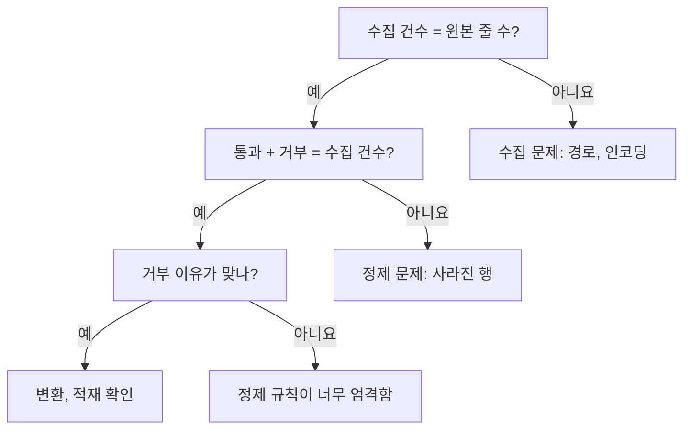

# 1. 데이터 파이프라인이란

!!! abstract "이번 장을 마치면"
    - [ ] 데이터 파이프라인의 네 단계를 그림 없이 말로 설명할 수 있다.
    - [ ] 각 단계의 입력과 출력을 짚을 수 있다.
    - [ ] 숫자가 안 맞을 때 어느 단계를 먼저 볼지 안다.
    - [ ] 네 개의 함수를 채워 작은 파이프라인을 직접 돌린다.

    예상 시간: 읽기 15분, 실습 30분

## 먼저, 전체 그림

오늘 만들 것은 이것 하나다. **프로젝트 문서 목록을 읽어서, 옵시디언에서 볼 수 있는 요약 노트 한 장을 만든다.**

<figure class="diagram">
<svg viewBox="0 0 600 196" role="img" aria-label="문서 6건이 수집, 정제, 변환, 적재를 거쳐 노트 한 장이 되고, 정제에서 2건이 거부된다">
<defs>
<marker id="f1-arrow" viewBox="0 0 10 10" refX="9" refY="5" markerWidth="7" markerHeight="7" orient="auto-start-reverse"><path d="M0,0 L10,5 L0,10 z" fill="currentColor"/></marker>
<marker id="f1-accent" viewBox="0 0 10 10" refX="9" refY="5" markerWidth="7" markerHeight="7" orient="auto-start-reverse"><path d="M0,0 L10,5 L0,10 z" fill="#e8590c"/></marker>
</defs>
<rect x="6" y="30" width="80" height="44" rx="8" fill="none" stroke="currentColor" stroke-opacity="0.45" stroke-dasharray="4 3"/>
<rect x="104" y="30" width="80" height="44" rx="8" fill="currentColor" fill-opacity="0.05" stroke="currentColor" stroke-opacity="0.6"/>
<rect x="202" y="30" width="80" height="44" rx="8" fill="#e8590c" fill-opacity="0.08" stroke="#e8590c" stroke-width="2"/>
<rect x="300" y="30" width="80" height="44" rx="8" fill="currentColor" fill-opacity="0.05" stroke="currentColor" stroke-opacity="0.6"/>
<rect x="398" y="30" width="80" height="44" rx="8" fill="currentColor" fill-opacity="0.05" stroke="currentColor" stroke-opacity="0.6"/>
<rect x="496" y="30" width="80" height="44" rx="8" fill="none" stroke="currentColor" stroke-opacity="0.45" stroke-dasharray="4 3"/>
<rect x="202" y="146" width="80" height="40" rx="8" fill="#e8590c" fill-opacity="0.08" stroke="#e8590c"/>
<path d="M86,52 H100" fill="none" stroke="currentColor" marker-end="url(#f1-arrow)"/>
<path d="M184,52 H198" fill="none" stroke="currentColor" marker-end="url(#f1-arrow)"/>
<path d="M282,52 H296" fill="none" stroke="currentColor" marker-end="url(#f1-arrow)"/>
<path d="M380,52 H394" fill="none" stroke="currentColor" marker-end="url(#f1-arrow)"/>
<path d="M478,52 H492" fill="none" stroke="currentColor" marker-end="url(#f1-arrow)"/>
<path d="M242,110 V142" fill="none" stroke="#e8590c" stroke-width="2" marker-end="url(#f1-accent)"/>
<g fill="currentColor" font-size="13" text-anchor="middle">
<text x="46" y="57">원천</text>
<text x="144" y="57" font-weight="700">1. 수집</text>
<text x="242" y="57" font-weight="700">2. 정제</text>
<text x="340" y="57" font-weight="700">3. 변환</text>
<text x="438" y="57" font-weight="700">4. 적재</text>
<text x="536" y="57">노트</text>
<text x="46" y="20" font-size="11">CSV 파일</text>
<text x="144" y="20" font-size="11">읽어 온다</text>
<text x="242" y="20" font-size="11">걸러 낸다</text>
<text x="340" y="20" font-size="11">요약한다</text>
<text x="438" y="20" font-size="11">저장한다</text>
<text x="536" y="20" font-size="11">wiki.md</text>
<text x="144" y="96" font-size="12">6건</text>
<text x="242" y="96" font-size="12" font-weight="700">통과 4건</text>
<text x="340" y="96" font-size="12">프로젝트 3개</text>
<text x="438" y="96" font-size="12">파일 1개</text>
<text x="242" y="171" font-size="12" fill="#e8590c" font-weight="700">거부 2건</text>
</g>
</svg>
<figcaption>들어온 6건이 어디서 몇 건으로 바뀌는지가 파이프라인의 전부다. 사라진 2건도 버리지 않고 이유와 함께 남긴다.</figcaption>
</figure>

비유하면 **정수장**이다. 강물을 끌어오고(수집), 찌꺼기를 거르고(정제), 마실 수 있게 처리해서(변환), 수도관으로 보낸다(적재).

## 왜 필요한가

프로젝트 3개의 문서를 손으로 정리한다고 해 보자. 처음에는 파일을 열어 복사하면 된다. 그런데 일주일 뒤 문서가 바뀌면 처음부터 다시 해야 한다. 어디선가 숫자가 틀려도 **언제 어떤 파일에서 틀렸는지 알 방법이 없다.**

파이프라인은 이 일을 **정해진 단계로 나누어 코드로 적어 둔 것**이다. 다시 돌리면 같은 결과가 나오고, 단계 사이에서 건수를 비교하면 문제가 생긴 곳을 찾을 수 있다.

## 데이터를 따라가 보자

아래 **다음** 버튼을 눌러 문서 6건이 어떻게 바뀌는지 직접 따라가 보자. **자동 재생**을 누르면 알아서 넘어간다.

<div id="walk-pipeline"></div>

## 네 단계의 공통 모양

단계 이름은 달라도 생김새는 같다. **입력을 받아서, 한 가지 일을 하고, 출력을 다음 단계에 넘긴다.**

| 단계 | 입력 | 하는 일 | 출력 | 잘못되면 이렇게 보인다 |
|---|---|---|---|---|
| 1. 수집 | CSV 파일 | 파일을 읽어 행 목록으로 | 6건 | 파일이 없다는 오류, 글자 깨짐 |
| 2. 정제 | 6건 | 규칙에 맞지 않는 행을 거부 | 통과 4건, 거부 2건 | 있어야 할 문서가 사라짐 |
| 3. 변환 | 통과 4건 | 프로젝트별 문서 수 계산 | 프로젝트 3개 | 합계가 원본과 다름 |
| 4. 적재 | 프로젝트 3개 | 노트 파일로 저장 | `wiki.md` | 노트가 비었거나 옛날 내용 |

단계를 나누어 두면 좋은 점은 **문제를 찾을 때** 드러난다. 노트의 숫자가 이상할 때는 앞에서부터 건수를 확인한다.



## 코드 해부: 거르는 코드의 모양

실습에서 가장 많이 쓸 모양이다. 행을 하나씩 보면서 조건에 맞는 것만 새 목록에 담는다.

```python
rows = [{"title": "소개"}, {"title": ""}]  # (1)!

good = []  # (2)!
for row in rows:
    if row["title"]:  # (3)!
        good.append(row)

print(len(rows), "->", len(good))  # (4)!
```

1. 행 하나는 딕셔너리 하나다. 열 이름으로 값을 꺼낸다.
2. 통과한 행을 담을 빈 목록을 먼저 만든다.
3. 빈 문자열 `""`은 거짓으로 취급되어 이 `if`를 통과하지 못한다.
4. 들어온 건수와 나간 건수를 함께 찍는다. 파이프라인의 기본 습관이다.

```text title="실행 결과"
2 -> 1
```

## 실습: 직접 파이프라인 돌리기

**미션:** `labs/01-what-is-pipeline/starter.py`의 함수 네 개를 채워 `output/wiki.md`를 만든다.

### 시작 전 준비

강의 폴더에서 터미널을 열고 가상환경을 켠다.

```powershell
.venv\Scripts\activate
```

입력 데이터는 `labs/01-what-is-pipeline/data/documents.csv`이다. 실제 자료가 아닌 연습용 데이터이며, 일부러 문제 있는 행을 넣어 두었다.

| repo | path | title | updated_at | 문제 |
|---|---|---|---|---|
| alpha-shop | README.md | 쇼핑몰 소개 | 2026-03-01 | |
| alpha-shop | docs/design.md | 설계 결정 | 2026-03-05 | |
| alpha-shop | docs/design.md | 설계 결정 | 2026-03-05 | 같은 문서가 두 번 |
| beta-blog | README.md | (공백 3칸) | 2026-04-02 | 제목이 없음 |
| beta-blog | docs/deploy.md | 배포 방법 | 2026-04-10 | |
| gamma-bot | README.md | 챗봇 소개 | 2026-05-20 | |

### 작업 순서

TODO를 **하나 채우고, 그것만 채점하고, 다음으로** 넘어간다.

| 순서 | 채울 함수 | 하는 일 | 이 명령으로 채점 |
|---|---|---|---|
| 1 | `extract` | CSV를 읽어 딕셔너리 목록으로 돌려준다 | `pytest labs/01-what-is-pipeline -k todo1` |
| 2 | `clean` | 제목 없는 행과 중복 행을 거부한다 | `pytest labs/01-what-is-pipeline -k todo2` |
| 3 | `summarize` | 프로젝트별 문서 수를 센다 | `pytest labs/01-what-is-pipeline -k todo3` |
| 4 | `load` | 요약을 노트 파일로 저장한다 | `pytest labs/01-what-is-pipeline -k todo4` |

처음 채점하면 `NotImplementedError: TODO 1: extract`가 나온다. **아직 안 채웠다는 뜻이니 정상이다.**

??? tip "TODO 1 힌트: extract"
    `csv.DictReader`는 첫 줄을 열 이름으로 써서 각 행을 딕셔너리로 준다.

    ```python
    with open(csv_path, encoding="utf-8", newline="") as f:
        return list(csv.DictReader(f))
    ```

??? tip "TODO 2 힌트: clean"
    순서는 이렇다.

    1. `good`, `rejected`, `seen`을 빈 목록과 빈 집합으로 만든다.
    2. `for row in rows:`로 하나씩 본다.
    3. `row["title"].strip()`이 비었으면 `rejected`에 `{**row, "reason": "제목 없음"}`을 담고 `continue`한다.
    4. `key = (row["repo"], row["path"])`를 만든다. 이미 `seen`에 있으면 `reason`을 `"중복"`으로 담고 `continue`한다.
    5. 통과한 행은 `seen`에 `key`를 넣고 `good`에 담는다.

??? tip "TODO 3 힌트: summarize"
    ```python
    counts = {}
    for row in rows:
        counts[row["repo"]] = counts.get(row["repo"], 0) + 1
    return counts
    ```

??? tip "TODO 4 힌트: load"
    `sorted(summary)`로 프로젝트 이름순으로 돌면서 `f"- {repo}: 문서 {count}개"` 줄을 만든다. `Path(output_path).parent.mkdir(parents=True, exist_ok=True)`로 폴더를 먼저 만들고, `write_text(..., encoding="utf-8")`로 저장한다.

### 다 채웠다면

```powershell
pytest labs/01-what-is-pipeline
python labs/01-what-is-pipeline/starter.py
```

이렇게 나오면 성공이다.

```text title="실행 결과"
[1 수집] 6건 읽음
[2 정제] 통과 4건, 거부 2건
  거부: alpha-shop/docs/design.md (중복)
  거부: beta-blog/README.md (제목 없음)
[3 변환] 프로젝트 3개
[4 적재] 저장 완료: wiki.md
```

만들어진 `labs/01-what-is-pipeline/output/wiki.md`를 옵시디언이나 메모장으로 열어 확인해 보자.

??? success "정답 보기"
    `labs/01-what-is-pipeline/solution.py`에 있다. 막혔을 때는 힌트를 먼저 보고, 그래도 안 되면 함수 하나만 열어 본다.

## 자주 하는 실수

!!! failure "`UnicodeDecodeError: 'cp949' codec can't decode byte ...`"
    `open()`에 `encoding="utf-8"`을 빠뜨렸다. 한국어 Windows는 기본 인코딩이 cp949라서 UTF-8 파일을 읽다가 실패한다.

!!! failure "`README.md`가 하나만 남고 전부 사라진다"
    중복 판단에 `path`만 썼다. `README.md`는 프로젝트마다 있으므로, **무엇이 같아야 같은 문서인지**를 `(repo, path)`로 정해야 한다. 이 '같음의 기준'을 키(key)라고 부른다.

!!! failure "공백만 있는 제목이 통과한다"
    `if not row["title"]:`은 빈 문자열만 잡는다. 공백 3칸은 비어 있지 않은 문자열이므로 `.strip()`을 먼저 한다.

## 확인 퀴즈

??? question "1. 수집 6건, 통과 3건, 거부 2건이 나왔다. 무엇이 문제일까?"
    3 + 2 = 5로 수집 건수 6과 맞지 않는다. **정제 단계에서 한 건이 말없이 사라졌다.** 거부 목록에도 없으니 코드에서 어떤 행을 빠뜨린 것이다.

??? question "2. 거부한 행을 그냥 버리지 않고 이유와 함께 남기는 이유는?"
    규칙이 잘못됐을 때 알아차리기 위해서다. 버리면 정상 문서가 사라져도 아무도 모른다.

??? question "3. 입력 파일은 그대로인데 노트 내용만 틀렸다. 어느 단계부터 볼까?"
    수집 건수부터 앞에서 차례로 본다. 건수와 거부 이유까지 맞으면 변환과 적재를 확인한다.

## 정리

- 파이프라인은 **입력 → 한 가지 일 → 출력**인 단계를 이어 붙인 것이다.
- 이번 장의 네 단계는 수집, 정제, 변환, 적재다.
- 단계마다 건수를 찍으면 문제가 생긴 곳을 찾을 수 있다.
- 같은 문서인지 판단하는 기준(키)을 먼저 정해야 한다.
