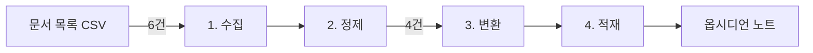

# 데이터 파이프라인 맛보기

!!! abstract "이 사이트는 샘플입니다"
    강의 형식이 공부하기에 맞는지 확인하기 위한 **1개 장짜리 샘플**이다. 전체 강의는 아직 없다.

## 이번 샘플에서 하는 일

## 레슨 목록

| # | 레슨 | 핵심 개념 | 만드는 것 |
|---|---|---|---|
| 0 | [환경 구성](00-setup.md) | 실행 준비 | 교재와 채점 실행 |
| 1 | [데이터 파이프라인이란](01-what-is-pipeline.md) | 수집, 정제, 변환, 적재 | 요약 노트를 만드는 파이프라인 |

## 진도 체크

- [ ] 0. 환경 구성
- [ ] 1. 데이터 파이프라인이란

## 이 강의 보는 법

1. 맨 위 그림으로 전체 구조를 먼저 본다.
2. 단계 넘겨 보기로 데이터가 바뀌는 과정을 따라간다.
3. `starter.py`의 TODO를 하나 채우고 그것만 채점한다.
4. 전부 통과하면 만들어진 노트를 직접 열어 본다.
